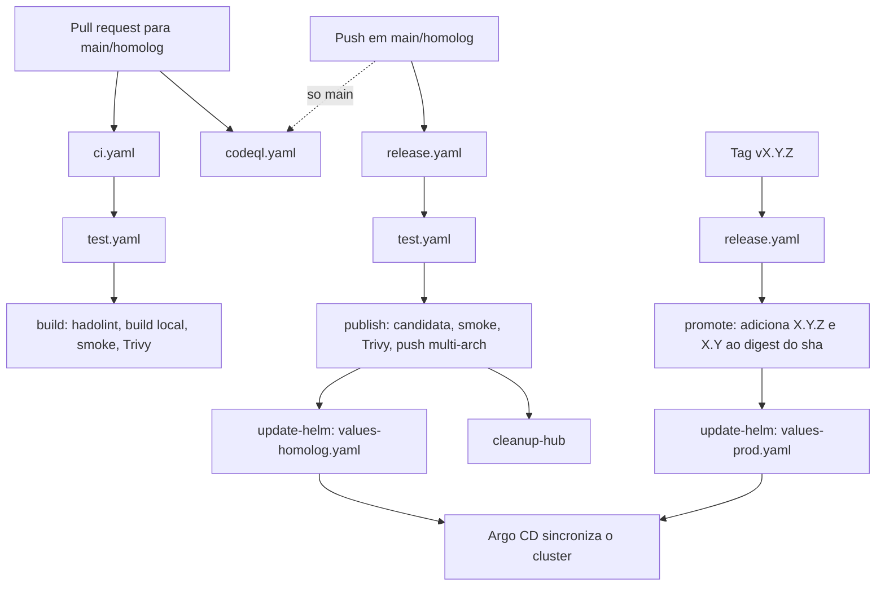

# Workflows do GitHub Actions

Este documento descreve a esteira de CI/CD do **Conversor de Temperatura**: quais workflows existem, quando cada um roda, o que cada job faz e como a imagem chega em homolog e produção.

---

## Visão geral

| Arquivo | Gatilho | Papel |
|---|---|---|
| `test.yaml` | `workflow_call` (reutilizável) | Checks de qualidade: Gitleaks, lint, testes e audit |
| `ci.yaml` | Pull request para `main` ou `homolog` | Valida o PR: testes + build da imagem **sem push**, smoke e Trivy |
| `codeql.yaml` | Pull request para `main`/`homolog` e push em `main` | Análise estática (SAST) do código JS e dos próprios workflows |
| `release.yaml` | Push em `main`/`homolog` e tag `v*` | Publica a imagem, promove para produção e atualiza o Helm (GitOps) |

Arquivos relacionados fora desta pasta:

- `scripts/smoke.sh` — smoke test da imagem (usado pela CI e pelo release).
- `scripts/cleanup-dockerhub.sh` — remove tags sha antigas do Docker Hub.
- `.github/dependabot.yml` — atualização automática de dependências npm, actions e imagem base.

---

## Fluxo completo



Resumo do ciclo de vida de uma mudança:

1. **PR** → `ci.yaml` e `codeql.yaml` validam a mudança. Nada é publicado.
2. **Merge em `homolog` ou `main`** → `release.yaml` testa de novo, publica a imagem com a tag `<git-sha>` e atualiza `values-homolog.yaml` no repo `helm-charts`. O Argo faz o deploy em homolog.
3. **Tag `vX.Y.Z` num commit da `main`** → `release.yaml` **não rebuilda**: reaproveita a imagem `<git-sha>` já testada, adiciona as tags de versão ao mesmo digest e atualiza `values-prod.yaml`. O Argo faz o deploy em produção.

---

## `test.yaml` — checks de qualidade (reutilizável)

Workflow chamado via `uses: ./.github/workflows/test.yaml` pela CI e pelo release. Assim, nenhuma imagem é publicada sem passar pelos mesmos checks do PR.

Os quatro jobs rodam **em paralelo**:

| Job | O que faz | Bloqueia? |
|---|---|---|
| **Gitleaks** | Procura segredos commitados em todo o histórico (`fetch-depth: 0`) | Sim |
| **Lint** | `npm ci` + `npm run lint` (ESLint) no Node 24 | Sim |
| **Testes (Node 22 / 24)** | `npm test` (Vitest) em matriz; publica o relatório JUnit como artifact `junit-node-<versão>` (7 dias) | Sim |
| **Auditoria de dependências** | `npm audit --audit-level=high` | Não (`continue-on-error`, só informativo) |

A matriz usa `fail-fast: false`: uma versão do Node falhando não cancela a outra, então dá para ver se o problema é específico de versão.

---

## `ci.yaml` — validação de pull request

**Gatilho:** pull request com destino `main` ou `homolog`.
**Concorrência:** um novo push no mesmo PR cancela a execução anterior (`cancel-in-progress: true`).

```
test (test.yaml) ──► build
```

Job **Build da imagem** (só roda se `test` passar):

1. **Lint do Dockerfile** — Hadolint, falha a partir de `warning`.
2. **Build local** — `docker/build-push-action` com `push: false` e `load: true`, gerando `conversor-temperatura:ci-<sha>`. Usa cache do GitHub Actions (`type=gha`).
3. **Smoke test** — `scripts/smoke.sh` sobe o container e valida a aplicação (ver [Smoke test](#smoke-test)).
4. **Trivy (relatório)** — lista vulnerabilidades `CRITICAL` e `HIGH` com correção disponível, sem bloquear.
5. **Trivy (gate)** — **falha o PR** se houver vulnerabilidade `CRITICAL` com correção disponível.

Como não há push nem uso de secrets, a CI funciona também em PRs vindos de fork.

---

## `codeql.yaml` — análise estática

**Gatilhos:** pull request para `main`/`homolog` e push em `main`.

Roda o CodeQL em matriz com duas linguagens:

- `javascript-typescript` — código da aplicação em `src/`.
- `actions` — os próprios workflows (injeção de expressão, permissões excessivas etc.).

Usa o conjunto de queries `security-extended`. A regra `actions/unpinned-tag` é excluída de propósito: as actions são referenciadas por tag (`@v7`), não por SHA, e o Dependabot mantém essas tags atualizadas.

Os resultados aparecem em **Security → Code scanning**.

---

## `release.yaml` — publicação e deploy

**Gatilhos:**

- Push em `main` ou `homolog`, **exceto** quando o commit altera apenas `**.md` ou `.k8s/**`.
- Push de tag `v*` (o filtro `paths-ignore` não se aplica a tags).

**Concorrência:** uma execução por ref, **sem cancelar** a que está em andamento — uma publicação nunca é interrompida no meio.

Variável global: `IMAGE_NAME=felipecs8/conversor-temperatura`.

### Quais jobs rodam em cada gatilho

| Job | Push em `homolog` | Push em `main` | Tag `vX.Y.Z` |
|---|---|---|---|
| `test` | ✅ | ✅ | — |
| `publish` | ✅ (tags `<sha>` + `homolog`) | ✅ (tags `<sha>` + `latest`) | — |
| `promote` | — | — | ✅ |
| `update-helm` | ✅ → `values-homolog.yaml` | ✅ → `values-homolog.yaml` | ✅ → `values-prod.yaml` |
| `cleanup-hub` | ✅ | ✅ | — |

> Push em `main` também atualiza **homolog**. Produção só muda via tag `v*`.

### Job `publish` — build e push da imagem

Roda só em push de branch, depois do `test`. Environment: `homolog`.

O princípio é: **nada vai para o Docker Hub antes de passar no smoke e no Trivy.**

1. **Docker metadata** — calcula as tags:
   - `<git-sha>` (sempre, formato longo — é a tag imutável usada no deploy);
   - `latest` (só na `main`);
   - `homolog` (só na branch `homolog`).
2. **Build da candidata (amd64)** — build local, sem push: `conversor-temperatura:candidate-<sha>`.
3. **Smoke test** na candidata.
4. **Trivy** — relatório de `CRITICAL`/`HIGH` e gate que falha em `CRITICAL` com correção.
5. **Build and push (multi-arch)** — só depois de tudo acima passar: build `linux/amd64` + `linux/arm64`, com **SBOM** e **provenance**, publicando as tags calculadas. O cache da candidata é reaproveitado, então o amd64 não é recompilado do zero.
6. **Job summary** — mostra digest, tag imutável e todas as tags publicadas.

### Job `promote` — promoção para produção

Roda só em push de tag. Environment: `production`.

Não faz build. Reaproveita a imagem `felipecs8/conversor-temperatura:<git-sha>` que o push na `main` já testou e publicou para o **mesmo commit** da tag:

1. Calcula as tags semver a partir da tag git: `v1.2.3` → `1.2.3` e `1.2`.
2. Falha se a tag não for semver (`vX.Y.Z`).
3. Falha se a imagem `<git-sha>` não existir no Docker Hub (ver [Problemas comuns](#problemas-comuns)).
4. `docker buildx imagetools create` — adiciona as tags de versão ao manifest existente (cópia de manifest no registry, sem rebuild).
5. Confere que cada tag nova aponta para exatamente o mesmo digest da origem.
6. Job summary com origem, digest e tags.

Resultado: o que vai para produção é **byte a byte** a mesma imagem que rodou em homolog.

### Job `update-helm` — deploy via GitOps

Roda depois de `publish` **ou** `promote` (o que tiver rodado com sucesso). Environment: `production` para tag, `homolog` para branch.

1. Faz checkout do repo [`fcavalcanti-devops/helm-charts`](https://github.com/fcavalcanti-devops/helm-charts) com o `HELM_CHARTS_TOKEN`.
2. Define ambiente e tag:
   - branch → `values-homolog.yaml` com tag `<git-sha>`;
   - tag `v1.2.3` → `values-prod.yaml` com tag `1.2.3`.
3. Atualiza `.application.image.tag` com `yq` em `charts/conversor-temperatura/values-<env>.yaml`.
4. Commita como `github-actions[bot]` (`chore(<env>): update conversor-temperatura to <tag>`). Se a tag já for a mesma, não há commit e o job termina com sucesso.
5. Faz `git push` com até 3 tentativas, rodando `git pull --rebase` entre elas.

O job tem um grupo de concorrência **global** (`update-helm-conversor-temperatura`): pushes simultâneos em `main`, `homolog` e tags entram em fila, em vez de competir pelo mesmo repositório.

A partir daí, o Argo CD (Applications no repo `gitops`) detecta a mudança e sincroniza o cluster.

### Job `cleanup-hub` — limpeza do Docker Hub

Roda depois do `publish` (só em push de branch), com `continue-on-error: true`: falhar aqui não marca o release como falho.

Executa `scripts/cleanup-dockerhub.sh`, que:

1. Autentica na API do Docker Hub.
2. Lista as tags do repositório (primeira página, até 100), ordenadas por última atualização.
3. Filtra só tags no formato sha (40 caracteres hex) — `latest`, `homolog` e semver nunca são removidas.
4. Mantém as `KEEP=10` mais recentes e apaga o restante.

---

## Smoke test

`scripts/smoke.sh <imagem> [porta]` é usado na CI e no `publish`. Ele:

1. Sobe o container (nome `smoke`) na porta 8080.
2. Espera até 20 s o `/health` responder.
3. Valida `GET /celsius/0/fahrenheit` → `"fahrenheit":32`.
4. Valida `GET /fahrenheit/32/celsius` → `"celsius":0`.
5. Valida que `GET /` contém `Conversor de Temperatura`.
6. Falha se o container estiver rodando como **root**.

Em falha, imprime `docker logs` do container. O container é removido no final (via `trap`) e também pelo step `Remove container` do workflow.

Para rodar localmente:

```bash
docker build -t conversor-temperatura:local .
bash scripts/smoke.sh conversor-temperatura:local
```

---

## Tags da imagem

| Tag | Quando é criada | Uso |
|---|---|---|
| `<git-sha>` | Todo push em `main`/`homolog` | **Imutável.** Usada no Helm de homolog e como origem da promoção |
| `homolog` | Push em `homolog` | Atalho móvel, não usar em deploy |
| `latest` | Push em `main` | Atalho móvel, não usar em deploy |
| `X.Y.Z`, `X.Y` | Tag git `vX.Y.Z` | Produção (mesmo digest do `<git-sha>` do commit) |

---

## Como fazer uma release para produção

1. Faça o merge na `main` e espere o `release.yaml` terminar (a imagem `<git-sha>` precisa existir).
2. Confira em homolog que está tudo certo.
3. Crie e envie a tag **no mesmo commit** da `main`:

```bash
git checkout main
git pull
git tag v1.2.3
git push origin v1.2.3
```

4. Se o environment `production` tiver aprovação obrigatória, aprove em **Actions → execução do Release**.

---

## Environments, permissões e secrets

**Environments** (Settings → Environments):

| Environment | Jobs |
|---|---|
| `homolog` | `publish`, `update-helm` (push de branch) |
| `production` | `promote`, `update-helm` (tag) |

Proteções como required reviewers ou restrição de branches/tags são configuradas no próprio environment.

**Permissões:** todos os workflows usam `contents: read` por padrão. Só o `codeql.yaml` recebe `security-events: write`, para enviar os resultados ao Code scanning. A escrita no repo `helm-charts` usa um token próprio, não o `GITHUB_TOKEN`.

**Secrets:**

| Secret | Usado por | Permissão necessária |
|---|---|---|
| `DOCKERHUB_USERNAME` | `publish`, `promote`, `cleanup-hub` | — |
| `DOCKERHUB_TOKEN` | `publish`, `promote`, `cleanup-hub` | Access token com **Read, Write, Delete** (o delete é para o cleanup) |
| `HELM_CHARTS_TOKEN` | `update-helm` | PAT com **Contents: write** em `fcavalcanti-devops/helm-charts` |

A CI de PR não usa nenhum secret.

---

## Dependabot

Configurado em `.github/dependabot.yml`, roda semanalmente:

- **npm** (`/src`) — segunda às 09:00 (America/Sao_Paulo), minor e patch agrupados num único PR, com cooldown de 7 dias para releases recém-publicadas. Majors continuam sendo propostas.
- **GitHub Actions** — todas as actions agrupadas num único PR.
- **Docker** (imagem base) — ignora majors, para não sair da LTS do Node escolhida.

Os PRs do Dependabot passam pela mesma `ci.yaml` e `codeql.yaml` de qualquer PR.

---

## Problemas comuns

**`promote` falha com "A imagem ... nao existe no Docker Hub"**
A tag foi criada num commit que não gerou imagem. Causas possíveis:
- o commit só alterou `.md` ou `.k8s/` (o `paths-ignore` não dispara o release);
- o commit não está na `main` / o release da `main` ainda não terminou;
- a tag sha já foi removida pelo `cleanup-hub` (mais de 10 publicações depois).

Solução: crie a tag no último commit da `main` que tenha um release com sucesso.

**`promote` falha com "nao e semver"**
A tag precisa seguir `vX.Y.Z` (ex.: `v1.2.3`).

**CI falha no "Fail on critical vulnerabilities"**
O Trivy encontrou CVE `CRITICAL` com correção disponível. Normalmente se resolve atualizando a imagem base (`node:*-alpine`) ou a dependência npm apontada no relatório do step anterior.

**`update-helm` falha no push**
Depois de 3 tentativas com `git pull --rebase`, o job falha. Verifique se o `HELM_CHARTS_TOKEN` não expirou e se ainda tem permissão de escrita no `helm-charts`.
